# MESS MATE

A web platform for hostel students to see the daily mess menu, rate meals, send feedback and
report service problems — and for the mess administrator to read the consolidated feedback.

This repository contains **the full implementation**: admin console, multi-mess discovery, E2E tests,
security checks, and deployment documentation. The seed data (4 messes, 10 students, 31 days) is
already verified against the database.

**Stack:** Next.js 16 (App Router) · React 19 · Tailwind CSS 4 · Supabase (Postgres + Auth)

---
## What's included

| Area | Status |
| --- | --- |
| Email/password signup, login, logout | ✅ |
| Role-based redirects (`student → /menu`, `admin → /admin`) | ✅ |
| Protected layout + navbar / mobile bottom nav + hamburger sheet | ✅ |
| Postgres schema with RLS for all six tables | ✅ |
| Seed: 4 messes, 10 students, 31 days × 3 meals | ✅ |
| Design system: warm palette, 48px+ tap targets, skeletons, error toasts | ✅ |
| Daily menu page (yesterday / today / tomorrow) with average ratings | ✅ |
| Tap-to-rate 1–5 stars, one editable rating per meal, optimistic UI | ✅ |
| Per-meal feedback (500 chars, live counter) + "My feedback" history | ✅ |
| Problem reports with category, description and status tracking | ✅ |
| Rate limiting on ratings, feedback and reports (server + DB trigger) | ✅ |
| Admin console: 5 stat cards, Recharts line + bar charts, needs-attention list, menu manager, feedback table, reports inbox with status triage | ✅ |
| Public multi-mess: directory, detail, compare (side-by-side 2–3) | ✅ |
| E2E test suite (Playwright, production build): 19 tests, 19 passed | ✅ |
| Security: 17/17 RLS checks pass (anon/student/admin boundaries) | ✅ |
| Deployment docs for Vercel + hosted Supabase | ✅ |

---
## Folder structure

```
.
├── app/
│   ├── layout.tsx                 # fonts, metadata, toast provider
│   ├── globals.css                # Tailwind 4 + warm design tokens
│   ├── page.tsx                   # session-aware entry redirect
│   ├── error.tsx                  # friendly error boundary
│   ├── not-found.tsx              # branded 404
│   ├── login/
│   │   ├── page.tsx               # login screen (redirects if already signed in)
│   │   └── actions.ts             # server action: signInWithPassword + role redirect
│   ├── signup/
│   │   ├── page.tsx               # student signup screen
│   │   └── actions.ts             # server action: signUp (name → user metadata)
│   ├── auth/callback/route.ts     # email-confirmation code exchange → role redirect
│   ├── (app)/                     # protected route group (navbar + bottom nav shell)
│   │   ├── layout.tsx             # auth guard + Navbar + BottomNav
│   │   ├── menu/                  # daily menu, rating + feedback actions
│   │   ├── my-feedback/           # student's comment history
│   │   ├── report/                # report form + status list + action
│   │   └── admin/                 # admin console
│   │       ├── layout.tsx         # authoritative role guard (admin only)
│   │       ├── page.tsx           # overview cards + charts + needs-attention
│   │       ├── menu/page.tsx      # menu manager + directory price
│   │       ├── feedback/page.tsx  # filterable, sortable comment table
│   │       ├── reports/page.tsx   # reports inbox + status triage
│   │       └── actions.ts         # saveMenu, deleteMenu, updateReportStatus, updateMessPrice
│   └── (public)/                  # signed-out-readable route group
│       ├── layout.tsx             # public shell (logo + log in / sign up)
│       └── messes/                # directory, [id] detail, compare
├── components/
│   ├── admin/                     # AdminTabs, StatCard, Recharts charts,
│   │                              # MenuEditor, ReportStatusControl, MessPriceForm
│   ├── auth/                      # AuthShell, LoginForm, SignupForm
│   ├── brand/logo.tsx             # steaming-bowl mark + wordmark
│   ├── discovery/                 # MessDirectory (search + compare picker), RatingBreakdown
│   ├── feedback/                  # feedback history list
│   ├── icons.tsx                  # inline SVG icon set (no icon dependency)
│   ├── layout/                    # Navbar, BottomNav, shared nav items
│   ├── menu/                      # date switcher, meal card, optimistic stars,
│   │                              # feedback box, average-star display
│   ├── reports/                   # report form, report list, status badge
│   └── ui/                        # Button, Field, Select, Textarea, SubmitButton,
│                                  # Skeleton, EmptyState, ToastProvider/useToast
├── lib/
│   ├── auth.ts                    # getSession(), homeForRole(), profile fallback
│   ├── data/                      # read layer: menus, feedback, reports,
│   │                              # admin (overview/tables/editor), discovery (public)
│   ├── validation.ts              # stars/text/category/date/price/menu-item rules + limits
│   ├── rate-limit.ts              # per-user submission limits (mirrors DB trigger)
│   ├── db-errors.ts               # friendly Postgres error messages
│   ├── meals.ts                   # meal metadata, IST dates, TREND_DAYS, formatting
│   ├── pricing.ts                 # ₹ formatting + monthly estimate
│   ├── database.types.ts          # typed schema for Supabase client
│   ├── actions/auth.ts            # logout server action
│   └── supabase/
│       ├── client.ts              # browser client
│       ├── server.ts              # server client (cookies)
│       ├── anon.ts                # session-less client for the public directory
│       ├── proxy.ts               # session refresh + route protection
│       └── env.ts                 # env validation with a helpful error
├── tests/                         # Playwright specs: auth, menu, admin, layout,
│                                  # performance, security + helpers.ts
├── playwright.config.ts           # runs against `next start` on port 3400
├── scripts/
│   ├── seed.mjs                   # idempotent seed script (service-role key)
│   ├── check-security.mjs         # 17 RLS checks over the public API (anon key only)
│   └── screenshots.mjs            # regenerates docs/screenshots (logs in first)
├── supabase/migrations/
│   ├── 0001_messmate_init.sql     # tables, enums, triggers, helper fns, RLS
│   ├── 0002_student_modules.sql   # rating summary RPC, rate limits, length checks
│   └── 0003_admin_multimess.sql   # price column, public read, mask_student_name,
│                                  # mess_directory_stats, mess_rating_breakdown,
│                                  # mess_recent_reviews, default-mess trigger, indexes
├── test-results/
│   └── results.json               # last Playwright test run JSON
├── docs/screenshots/              # 14 PNGs (1280× and 360× for 7 pages)
└── package.json
```

---
## Environment variables

Copy `.env.example` to `.env.local`:

```bash
cp .env.example .env.local
```

| Variable | Where it is used | Notes |
| --- | --- | --- |
| `NEXT_PUBLIC_SUPABASE_URL` | browser + server clients, proxy | Supabase → Project Settings → API |
| `NEXT_PUBLIC_SUPABASE_ANON_KEY` | browser + server clients, proxy | Public; RLS protects the data |
| `SUPABASE_SERVICE_ROLE_KEY` | `scripts/seed.mjs` only | **Server-only.** Bypasses RLS. Never expose it to the app or the browser |

Supabase also injects `SUPABASE_URL` etc. into Edge Functions — not used here.

---
## Setup

### 1. Create a Supabase project

1. <https://supabase.com/dashboard> → **New project** (pick the region closest to you).
2. **Project Settings → API** → copy the project URL, the `anon` key and the `service_role` key into `.env.local`.

### 2. Apply the migrations

Paste the three migration files into the **SQL Editor** and run them in order, or use the CLI:

```bash
npx supabase link --project-ref <your-project-ref>
npx supabase db push
```

- `0001_messmate_init.sql` creates tables, enums, triggers, helper functions and RLS policies
- `0002_student_modules.sql` adds RPCs, rate-limit triggers, character checks and indexes
- `0003_admin_multimess.sql` adds `price_per_meal` to `messes`, public-read policies for
  `messes`/`menus`, `mask_student_name`, `mess_directory_stats`, `mess_rating_breakdown`,
  `mess_recent_reviews`, default-mess trigger, and supporting indexes

Run **0001 first, then 0002, then 0003** (`db push` applies them in order if pasted by hand).

### 3. Auth settings

**Authentication → Sign In / Providers → Email**

- Local development: turn **Confirm email** off so signup logs you straight in.
- Production: keep it on, then set **Authentication → URL Configuration**:
  - Site URL: `http://localhost:3000` (dev) / your deployed origin (prod)
  - Redirect URLs: `http://localhost:3000/auth/callback`, `<prod-origin>/auth/callback`

### 4. Seed

```bash
npm run seed
```

Idempotent — safe to re-run. It creates:

- 4 messes: Sunrise Hostel Mess, Green Valley Hostel Mess, Shree Sai Chatralaya, Hilltop Boys Hostel Mess
- 1 administrator + 10 students, all sharing one demo password

The exact account emails and that password are listed at the top of `scripts/seed.mjs`
(the `MESSES` array and the `PASSWORD` constant) rather than repeated here, because they
are **local-demo credentials, not something to publish or reuse**.

> **Never seed these into a hosted project you care about.** They are guessable, shared
> across every account, and one of them is an admin. If you do seed a deployed database,
> delete the users afterwards (Dashboard → Authentication → Users) or change every
> password first.

- 31 days of menus (breakfast, lunch, dinner) with weighted ratings, feedback and reports
- `mess_directory_stats` and `mess_rating_breakdown` RPC summary rows

### 5. Run

```bash
npm install
npm run dev          # http://localhost:3000
npm run build        # production build
npm run start        # serve the production build
npm run lint         # eslint
npm run check:security   # run the Node security verification script
npm run seed          # idempotent re-seed
```

Requires Node 20.9+ (tested on Node 24).

### Local Supabase instead of a hosted project

Docker Desktop + the Supabase CLI can run the whole backend locally:

```bash
npx supabase start        # prints the API URL and local keys
npx supabase db reset     # applies all three migrations to the local database
npm run seed              # .env.local already points at 127.0.0.1:54321
npx supabase stop         # when you are done
```

`.env.local` ships with the standard local keys; replace them with your hosted
project's values before pointing the app at production.

---
## Deploy on Vercel

### 1. Hosted Supabase first

The app talks to Supabase over its REST/Auth endpoints, so the database must
exist before the deploy works. For a hosted project:

```bash
npx supabase login
npx supabase link --project-ref <your-project-ref>
npx supabase db push          # applies 0001 → 0002 → 0003
```

Then, in the Supabase Dashboard → **Authentication → URL Configuration**:

- Site URL: `https://<your-app>.vercel.app`
- Additional Redirect URLs: `https://<your-app>.vercel.app/auth/callback`

Email confirmation can stay on in production; `app/auth/callback/route.ts`
exchanges the code for a session and writes the cookies.

### 2. Import the repo

1. Push this folder to GitHub, then Vercel → **Add New → Project → Import**.
2. Framework preset **Next.js** (detected automatically). Build command `npm run build`,
   output directory `.next`, Node 20.9+ (tested on 24).
3. Nothing else to configure — `proxy.ts` runs on the Edge runtime and reads only
   the two public variables.

### 3. Environment variables

Vercel → **Project → Settings → Environment Variables**. Add all three to
*Production* and *Preview*:

| Variable | Value | Notes |
| --- | --- | --- |
| `NEXT_PUBLIC_SUPABASE_URL` | `https://<ref>.supabase.co` | from Project Settings → API |
| `NEXT_PUBLIC_SUPABASE_ANON_KEY` | the `anon` key | public by design; RLS is the guard |
| `SUPABASE_SERVICE_ROLE_KEY` | — | **do not add it to Vercel.** Nothing at runtime needs it |

The service-role key is only read by `scripts/seed.mjs`, which you run from your
own machine with `--env-file-if-exists=.env.local`. Keeping it out of Vercel
means a leaked build log cannot hand out an RLS-bypassing credential. If you
must seed from CI, use a protected, masked secret on a job that is not the app
runtime, never a project-wide environment variable.

Redeploy (or bump the commit) after changing variables so the build picks them up.

### 4. Seed the production database

`scripts/seed.mjs` reads `NEXT_PUBLIC_SUPABASE_URL` and `SUPABASE_SERVICE_ROLE_KEY`
from the environment, so point `.env.local` at the hosted project and run the seed
from your own machine:

```bash
npm run seed          # --env-file-if-exists=.env.local, no Vercel involvement
```

Seeding is idempotent, but it writes the shared-password demo accounts described in
**Setup → 4. Seed**. For a deployment that is not a throwaway demo, either skip the
seed and create your own mess + users, or delete the seeded users immediately
afterwards (Dashboard → Authentication → Users).

### 5. Verify the deploy

```bash
npm run check:security                                  # 17 RLS checks against the hosted project
npx playwright test --headed --base-url https://<your-app>.vercel.app
```

`check:security` uses the anon key only, so it proves row-level security from the
outside. Then confirm:

- `https://<app>/messes` renders signed out, with prices and today's menus
- a student login lands on `/menu`, and `/admin` redirects them to `/menu`
- the admin console shows charts, the feedback table and the reports inbox

### Rollback / local parity

`npx supabase db reset` re-applies all three migrations from scratch, so a
preview deploy can always be pointed at a clean copy of the schema before
shipping.

---
## Student flow (under 30 seconds)

1. **Log in** → lands on `/menu` for today.
2. **Tap a star** on any meal — saved instantly, one rating per meal, editable.
3. **Write feedback** (optional) — 500 character cap with a live counter.
4. **Report** a service problem in two taps: pick a category, describe it, send.

Every write is validated on the client *and* re-validated on the server, rate
limited per user, and reflected immediately through `revalidatePath`.

---
## Admin console

The admin console lives at `/admin` and is split into tabbed pages, all guarded by a role check
in `app/(app)/admin/layout.tsx` and re-checked in every server action.

**/admin** — overview cards showing:
- Today/week/month average ratings
- Total feedback and open reports count
- "Needs attention" list of recent meals averaging below 2.5 stars
- Recharts: 30-day per-meal line chart + breakfast/lunch/dinner bar chart

**/admin/menu** — menu manager: add, edit or delete any date + meal type in the mess you manage
(the profile's `mess_id` decides which mess). Each day's menu section is labeled
`{Breakfast|Lunch|Dinner}`; dishes are entered one per line. Publish/Update/Delete actions
revalidate `/admin` and `/menu`, and the same page edits the directory price.

**/admin/feedback** — student feedback table, filterable by date range (`from/to`), meal type,
and sortable by `date`, `stars`, or `student`. Renders as a responsive table on laptops and as
a card list on phones (under 360 px wide). Each row shows: student name, meal, date, star rating,
and comment snippet.

**/admin/reports** — reports inbox with category filter, status pills (open → in progress →
resolved), and a status-change dropdown per report. Only the admin can triage reports; students
cannot change status. Status changes revalidate `/admin/reports` and `/admin`.

---
## Multi-mess discovery

**/messes** — public directory showing all messes with name, location, average rating, today's
menu preview, and `price_per_meal`. Sortable by rating, price, or name. Searchable.

**/messes/[id]** — detail page with today's menu, price, rating breakdown (stars distribution),
per-meal averages, and recent reviews shown as masked initials (e.g. "A. S.").

**/messes/compare** — side-by-side comparison of up to 3 messes, showing rating average,
price per meal, and today's menu for each.

---
## Screenshots

Captured from the production build at 1280 px (laptop) and 360 px (phone) with
`npm run screenshots`, which signs in first so the protected pages show real data.

| Page | Laptop | Phone |
| --- | --- | --- |
| Student menu (`/menu`) | 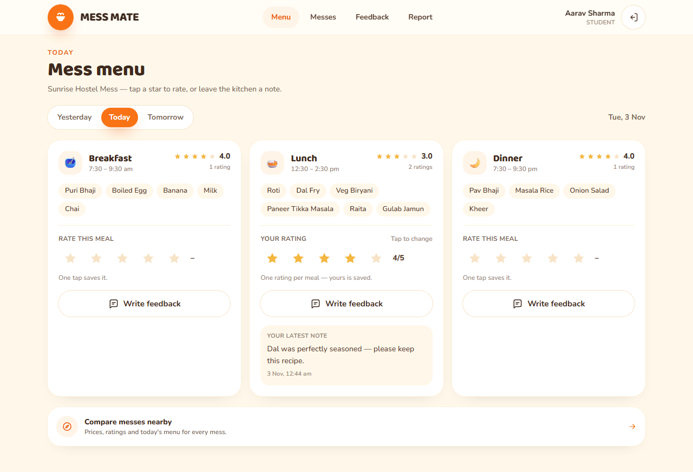 | 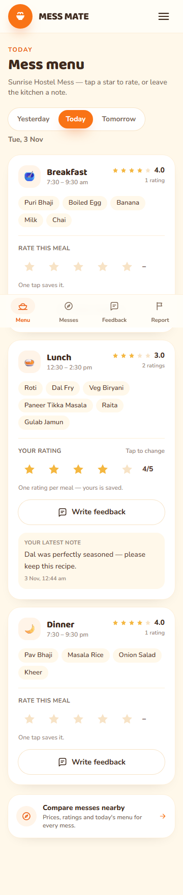 |
| Mess directory (`/messes`, signed out) | 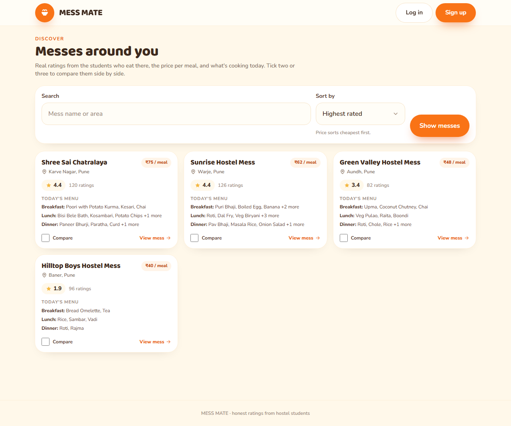 | 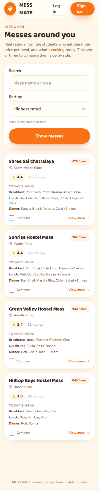 |
| Mess detail (`/messes/[id]`) | 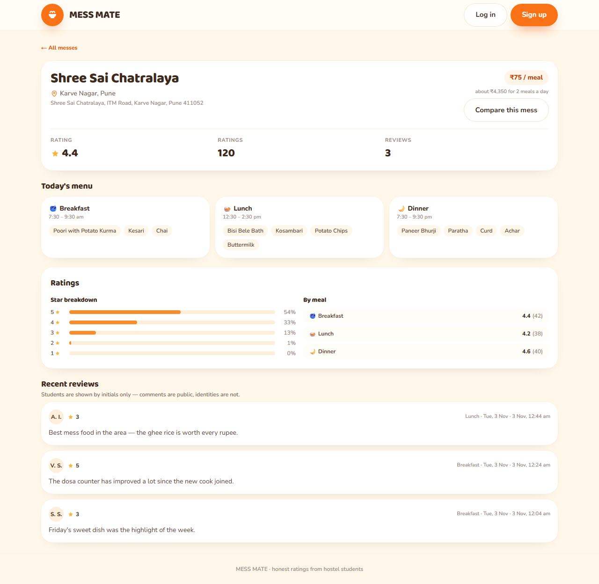 | 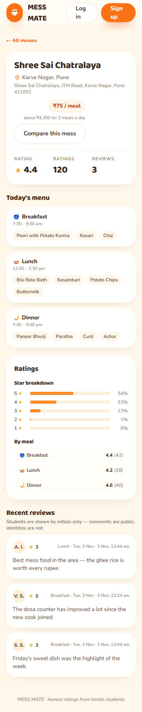 |
| Compare (`/messes/compare`) | 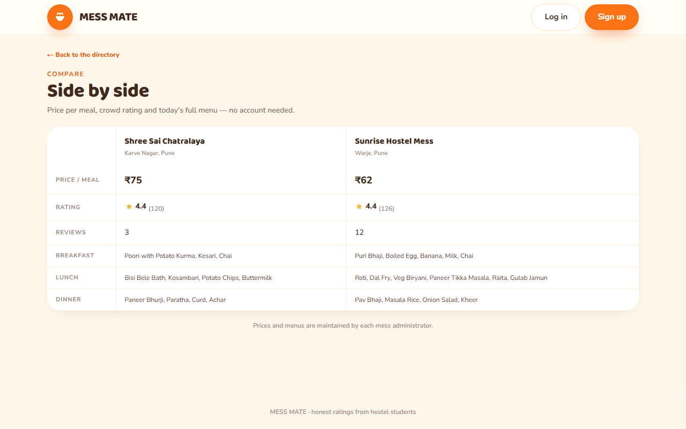 | 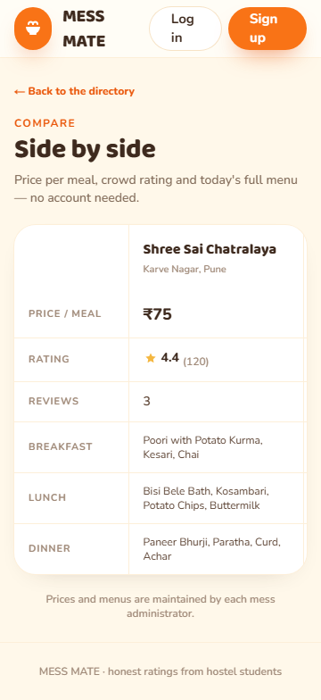 |
| Admin overview (`/admin`) | 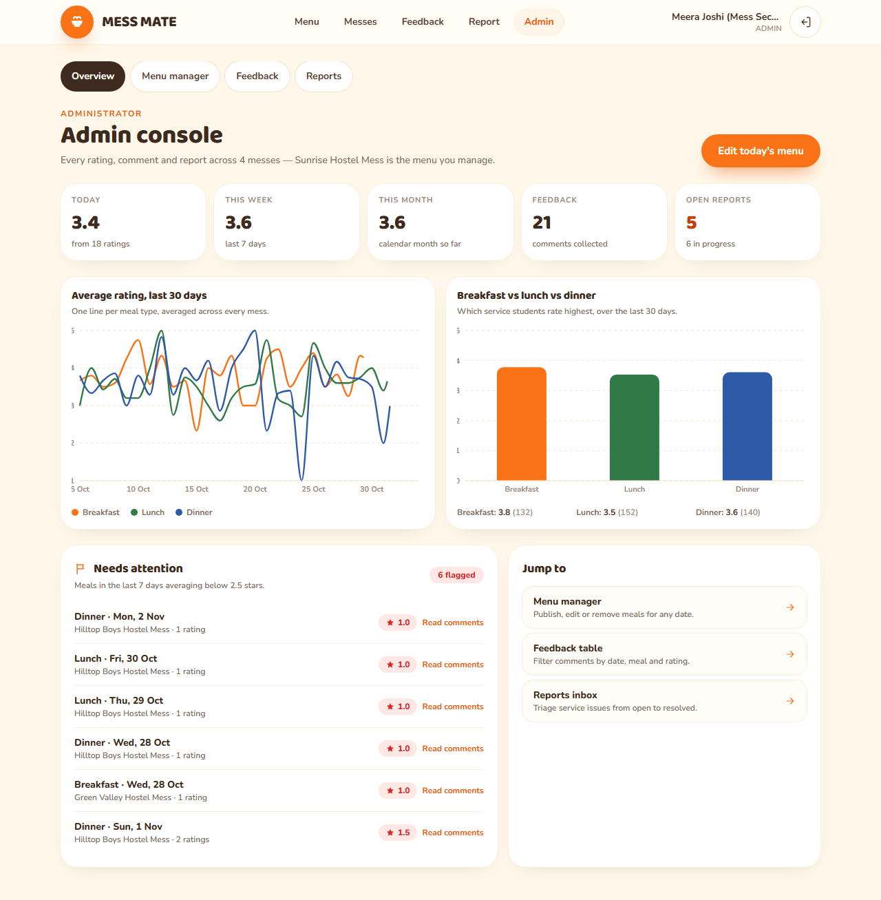 | 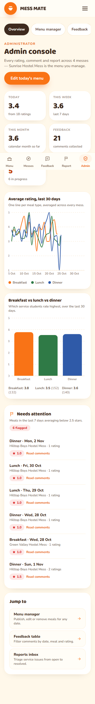 |
| Admin feedback (`/admin/feedback`) | 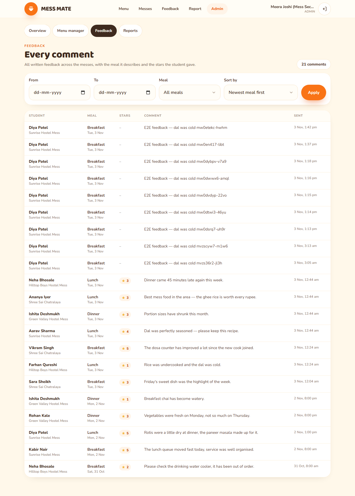 | 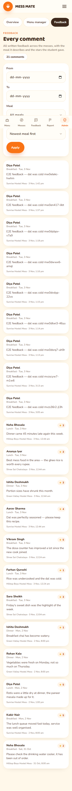 |
| Reports inbox (`/admin/reports`) | 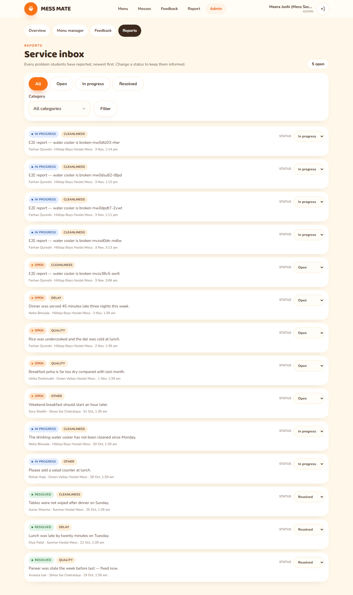 | 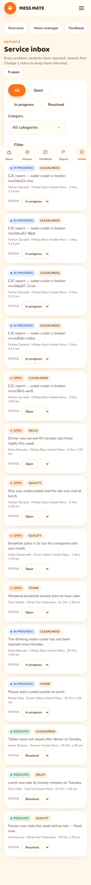 |

---
## E2E test results

Last run: `npm run test:e2e` (production build, `next start`, Chromium) —
**19 tests, 19 passed, 0 failed, 0 flaky** in 36 s. Full JSON: `test-results/results.json`.

| # | Requirement covered | Test | Time | Result |
| --- | --- | --- | --- | --- |
| 1 | valid login | authentication: valid credentials land the student on today's menu | 1.3 s | ✅ Pass |
| 2 | invalid login | authentication: invalid credentials are rejected and keep the session out | 0.4 s | ✅ Pass |
| 3 | admin-only entry | authentication: the administrator lands on the admin console | 1.4 s | ✅ Pass |
| 4 | menu loads for today | menu: today's menu loads all three meals with dishes | 1.3 s | ✅ Pass |
| 5 | rating saved and linked to its meal | menu: a rating is saved against the meal it belongs to and survives reload | 1.8 s | ✅ Pass |
| 6 | feedback visible to admin | admin: a student comment appears in the admin feedback table | 3.4 s | ✅ Pass |
| 7 | report reaches the admin dashboard | admin: a report reaches the admin inbox and can be triaged | 3.8 s | ✅ Pass |
| 8 | admin overview cards + charts + flags | admin: the dashboard shows overview cards, charts and weak meals | 2.4 s | ✅ Pass |
| 9 | menu manager CRUD | admin: the menu manager publishes a meal students can see | 3.9 s | ✅ Pass |
| 10 | phone layout | layout: the student screens fit without sideways scrolling (360 px) | 1.5 s | ✅ Pass |
| 11 | phone layout (tables) | layout: the admin tables switch to cards and stay inside the viewport | 1.5 s | ✅ Pass |
| 12 | phone layout (public) | layout: the public directory works signed out on a phone | 0.2 s | ✅ Pass |
| 13 | laptop layout | layout: desktop navigation is visible and the bottom bar is not | 1.3 s | ✅ Pass |
| 14 | page load < 2 s | performance: the public directory renders in under 2 seconds | 0.25 s | ✅ Pass |
| 15 | page load < 2 s | performance: a mess detail page renders in under 2 seconds | 0.47 s | ✅ Pass |
| 16 | page load < 2 s | performance: the student menu renders in under 2 seconds after login | 1.7 s | ✅ Pass |
| 17 | students blocked from private data | security: anonymous visitors are bounced from every private route | 0.4 s | ✅ Pass |
| 18 | students blocked from `/admin` | security: a student cannot open the admin console or its sub-pages | 2.0 s | ✅ Pass |
| 19 | passwords never exposed | security: no page leaks a password or a server key | 1.9 s | ✅ Pass |

The three performance tests assert a 2 000 ms wall-clock budget; the slowest
measured page was the post-login student menu at 1.7 s.

Re-run with:

```bash
npm run test:e2e        # next build && playwright test
npm run test:e2e:only   # reuse the existing build
```

Tests are re-runnable: students are capped at 3 reports/hour and 5 comments per
10 minutes by the database triggers, and the report test asserts whichever
report the student actually has saved rather than assuming headroom.


---
## Security (17/17 checks pass)

Three layers, each independently verified:

1. **Row-level security** is the authority. `scripts/check-security.mjs` talks to
   the public REST API with the anon key only — the same power a browser has — and
   proves the boundaries below.
2. **Server-side role checks.** `app/(app)/admin/layout.tsx` redirects any profile
   whose `role !== "admin"`, and every action in `app/(app)/admin/actions.ts`
   re-runs `requireAdmin()` before touching the database. The nav hiding the Admin
   link is convenience, not security.
3. **No secret on the page.** `SUPABASE_SERVICE_ROLE_KEY` is read only by
   `scripts/seed.mjs` in Node; it is never imported by app code and never prefixed
   with `NEXT_PUBLIC_`. Passwords live in `auth.users`, which the API does not
   expose; `profiles` carries only `id, name, role, mess_id, created_at`.

- Anonymous readers get zero feedback/rating/report/profile rows from the API
- A student sees **only their own** rows (ratings, feedback, reports, profile)
- Cross-mess rating and spoofed-feedback writes are rejected by RLS
- Report triage returns 0 rows for students
- `auth.users` is not readable from the API
- The admin legitimately sees 424 ratings from 10 students
- Profile rows carry no password material (`password`, `secret`, `token`)
- Public pages never return raw ratings or comments — only the aggregates and
  masked initials produced by the `0003` security-definer functions

The Node verification script is at `scripts/check-security.mjs` and is invoked via
`npm run check:security`.

---
## Design system

Tokens live in `app/globals.css` under `@theme`:

| Token | Value | Use |
| --- | --- | --- |
| `cream-100` / `cream-50` | `#fff8ea` / `#fffdf7` | page + card surfaces |
| `brand-500` / `brand-600` | `#f97316` / `#ea580c` | primary actions, active nav |
| `cocoa-900` / `cocoa-500` | `#3e2a1e` / `#806a58` | headings / body copy |
| `leaf-100` / `leaf-700` | `#dff3e4` / `#2f7a46` | "all good" badges |
| `danger` / `danger-soft` | `#dc2626` / `#fde8e6` | errors, toasts |
| `--font-display` | Baloo 2 | headings, wordmark |
| `--font-sans` | Nunito | body, labels |

Conventions: pill buttons at `h-12`/`h-14` (48–56 px tap targets), `rounded-3xl` cards with
`--shadow-warm`, mobile-first layouts, skeletons from `components/ui/skeleton.tsx`, and every
failure surfaced with `useToast()` plus an inline message.

---
## How auth works

1. `proxy.ts` (Next 16's renamed middleware) refreshes the Supabase cookie on every request and
   redirects signed-out visitors to `/login?next=…`.
2. Server Components/Actions use `lib/supabase/server.ts`; the browser uses
   `lib/supabase/client.ts`.
3. `getSession()` in `lib/auth.ts` reads the user and their profile once per request.
4. Login/signup actions read `profiles.role` and redirect with `homeForRole()`.
5. `app/(app)/layout.tsx` re-checks the session server-side, and
   `app/(app)/admin/layout.tsx` re-checks the role for every admin sub-page —
   the nav hiding the Admin link is convenience, not security.

---
## Next milestones / gaps

**Shipped in this pass:** admin console (overview cards, Recharts trend + meal
comparison, needs-attention flags, menu manager, feedback table, reports inbox),
multi-mess discovery (directory, detail, compare, `price_per_meal`), 4 seeded
messes with distinct ratings and prices, 19/19 E2E tests, 17/17 security checks,
Vercel + Supabase deployment docs.

Still open, roughly in priority order:

1. **One mess per administrator.** `getAdminMess()` reads the admin's own
   `profile.mess_id`, so the menu manager edits one mess even though the overview
   aggregates all of them. A super-admin needs a mess picker plus an RLS policy
   that lists the messes they may write.
2. **Reports have no delete path.** RLS lets students insert and read their own
   reports but never delete, and admins only update status. That is deliberate,
   but it means a test run cannot clean up after itself, so the report test
   tolerates the 3-per-hour limit instead. A documented purge job (or an
   admin-delete policy) would make the suite fully self-cleaning.
3. **No unit-test runner.** Vitest/Testing Library are not installed (the install
   does not complete in this environment), so the pure helpers
   (`lib/validation.ts`, `lib/pricing.ts`, the aggregation maths inside
   `lib/data/admin.ts`) are only covered indirectly through the E2E suite. Fast
   failing units would be cheap to add once the runner lands.
4. **Aggregation happens in Node, not Postgres.** The overview pulls up to 30 days
   of menus and ratings and reduces them in JS, and the directory filters search
   terms in JS. Fine at demo scale; a `security definer` RPC (like
   `mess_directory_stats` already is) would scale better.
5. **Hard row caps, no pagination.** Feedback 400, reports 200, directory 100
   messes. The UI says when a list is truncated, but there is no next page.
6. **No notifications** when a report's status changes, and no email/push channel.
7. **Menu page shows three days** (yesterday/today/tomorrow); a weekly view would
   use the same data that is already seeded.
8. **Public pages are not cached.** `/messes` and `/messes/[id]` render per
   request; `revalidate`/ISR or a short CDN TTL would cut database load, and the
   2 s budget should be re-measured against a hosted region.
9. **No CI.** `npm run lint`, `npx tsc --noEmit`, `npm run check:security` and
   `npm run test:e2e` all pass locally but nothing runs them on push.
10. **Demo credentials are fixed and shared.** The seed gives every account the same
    password (see `scripts/seed.mjs`), so it is guessable — rotate or delete those
    users before any real deployment, and never reuse them for a hosted project.
11. **Masked initials can collide** inside a mess (`A. S.` twice), and prices are
    per-mess only — no per-meal or slab pricing.

---
## License

MIT